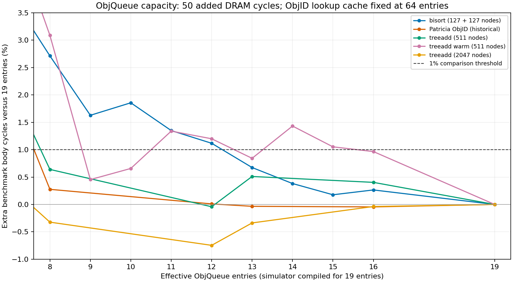
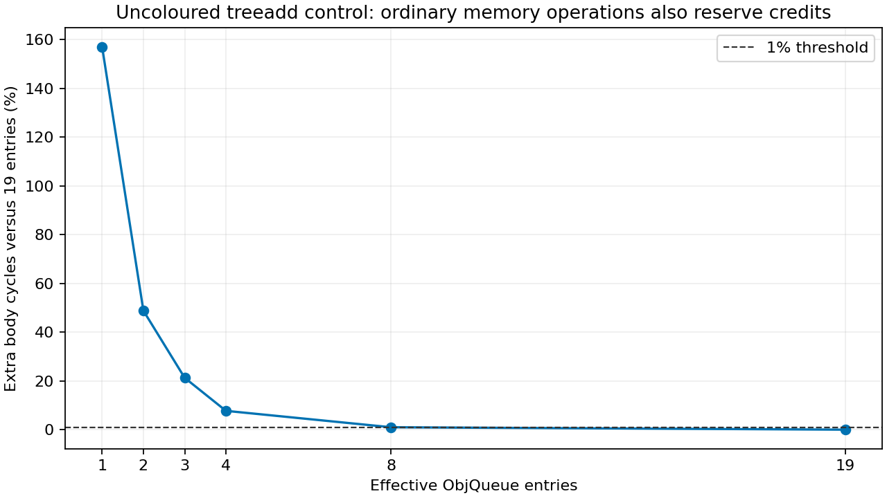

# ObjQueue capacity study — 17 November 2026

**13 entries is the minimum effective capacity meeting a 1% body-cycle budget
on all five workload variants.** Its largest overhead is **0.84%**, versus
**0.97% at 16 entries**. Every capacity from 1 through 12 failed at least one
workload. These are workload-specific simulation results, not zero-overhead
or FPGA-area claims.

For an FPGA configuration I would start with **16 entries**: it has three
extra credits at the same four-bit index width as 13, and a separately compiled
16-entry simulator reproduces every workload's sweep result exactly. Both 13
and 16 use 16-address payload register files; 19 uses five-bit indexing and
32-address files. Thirteen saves some control entries relative to 16, but does
not halve payload-bank depth again. Synthesis is needed to measure the actual
LUT/register savings. The production queue default has not been changed.

The Olden ports and validated ELF binaries are pushed:

* [Olden source: CHERID](https://github.com/CTSRD-CHERI/Toooba-olden/tree/CHERID), commit `ea2c0e9`.
* [Simulator benchmark suite: CHERID](https://github.com/CTSRD-CHERI/toooba-sim-benchmarks/tree/CHERID), containing only ObjID-adapted root binaries.

## Results

Percentages below are extra **benchmark body cycles** relative to 19 entries.
There is no averaging across workloads. Positive values mean slower.

| Workload | 4 entries | 8 entries | 12 entries | 13 entries | 16 entries | 19 entries |
| --- | ---: | ---: | ---: | ---: | ---: | ---: |
| bisort-objid.bin | +12.06% | +2.71% | +1.12% | +0.67% | +0.27% | +0.00% |
| patricia.bin | +7.63% | +0.28% | +0.01% | -0.03% | -0.04% | +0.00% |
| treeadd-objid.bin | +6.93% | +0.64% | -0.04% | +0.51% | +0.40% | +0.00% |
| treeadd-warm-objid.bin | +11.45% | +3.09% | +1.20% | +0.84% | +0.97% | +0.00% |
| treeadd-wide-objid.bin | +2.34% | -0.32% | -0.75% | -0.34% | -0.04% | +0.00% |

[Full-range figure](results/queue-overhead.png),
[CSV ledger](results/cycles.csv), [JSON ledger](results/cycles.json), and
[all measured cycle counts](results/table.md). SVG versions accompany the PNGs.

The curve is not monotonic:14 and15 fail the warm-tree criterion although 13
passes. Each capacity1–16 was tested on at least one sensitive workload;
remaining workloads were unnecessary once a capacity exceeded 1%. Full suites
were run at 4, 8, 12, 13, 16 and 19. This screening does not infer unmeasured results
from a monotonicity assumption. Capacities 17 and 18 were not needed to identify
the minimum. Every tested reduction slows at least one workload, so the 13-entry
finding uses the stated 1% tolerance, not a claim of zero cost.

| Entries | Largest measured body overhead | Workloads tested | Meets 1% on every workload? |
| ---: | ---: | ---: | --- |
| 1 | +110.71% | 1/5 | fails |
| 2 | +42.52% | 1/5 | fails |
| 3 | +22.72% | 1/5 | fails |
| 4 | +12.06% | 5/5 | fails |
| 5 | +7.45% | 1/5 | fails |
| 6 | +5.26% | 1/5 | fails |
| 7 | +3.86% | 1/5 | fails |
| 8 | +3.09% | 5/5 | fails |
| 9 | +1.63% | 2/5 | fails |
| 10 | +1.86% | 2/5 | fails |
| 11 | +1.35% | 2/5 | fails |
| 12 | +1.20% | 5/5 | fails |
| 13 | +0.84% | 5/5 | passes |
| 14 | +1.43% | 2/5 | fails |
| 15 | +1.05% | 2/5 | fails |
| 16 | +0.97% | 5/5 | passes |
| 19 | +0.00% | 5/5 | passes |

The uncoloured control is **0.996% slower at 8**, **7.72% at 4**, and **157.07%
at 1**. Ordinary memory instructions reserve ObjQueue credits at rename too;
no-check/buffer-hit requests return them later. Reclamation follows the queue's
head, so a completed younger reservation can wait behind an older one. The
control confirms that queue sizing can affect ordinary memory throughput,
not just outstanding metadata misses. These runs do not separately quantify
the contribution of each internal stall cause.

## Model and validation

The source base is public Toooba commit
`60d7c8295eceb3cc8c4249753d70866c300d47fc`, branch
`CHERID_eval_Reloaded_objid_lsoq`. The isolated study control commit is
`622ef1a1`. CPU configuration is CORE_SMALL, one core, CACHE_LARGE, TSO,
with the existing prefetcher settings. The independent ObjID **queue** varies;
the **64-entry ObjID lookup cache** (16 sets × 4 ways) and three translation
reservations stay fixed.

The normal Bluesim SoC reuses `mkAXI4_DelayShim` on the DRAM-controller route,
before its deburster. It adds 50 cycles to read addresses and write responses;
controller/buffering overhead remains in addition to that. L1/LLC hits and
peripheral accesses do not traverse this shim. The delay FIFO depth is 128.
[The standalone AXI test](delay-test/Test.bsv) passes exact 50-cycle AR/B delay
and one-request-per-cycle throughput. `+memlat0` selects zero added delay.

The initial sweep compiles 19 entries and limits the allocation ring to N with
`+objqN`. No entries outside that ring can be allocated. To check this model,
separate simulators were compiled with actual 8- and 16-entry queue types and
the production queue implementation, without the runtime ring selector.
**All ten independent runs matched body cycles, whole-program cycles and
tohost results exactly.** These are separately compiled simulation checks,
not FPGA implementation checks. [Generated capacity evidence](models/generated-capacities.json)
confirms8/16/19 control entries and3/4/5-bit indices.
[The comparison ledger](results/physical-validation.json) records all ten runs.
No separate13-entry build was made.

Positive ObjID load/store probes pass. Opposite-ID load and store probes
require the expected CHERI exception, and verify that the faulting store did
not change the value. Expected ID 2 has the opposite low bit to stored ID 1;
zero would bypass the check. Probes pass both the reference and separately
compiled 16-entry models. The integrated LSQ regression passes credit
exhaustion, wraparound, execute-time credit return, squash/reuse, fault
draining and same-cycle speculation cases. Full-trace and quiet reference
models matched all three probe cycle counts and results.

Repeated 19-entry baseline runs matched exactly. One 13-entry Patricia attempt
was interrupted without a result and discarded; the completed rerun used an
output-only retirement progress link. Its probe clocks/results matched the
full-trace model. Simulation scheduling, state and memory operations were not
changed by that output filter. Incomplete attempts and failed preliminary
benchmark drivers are excluded from all timing tables.

## Workloads and limits

* Treeadd: 511 bounded, coloured nodes, four sum-checked traversals, timed end to end.
* Treeadd-wide: 2047 nodes and four checked traversals, timed end to end.
* Treeadd-warm: 511 nodes; allocation and one validation traversal precede the timed four traversals.
* Bisort:two identical 127-node coloured trees, sorted ascending/descending independently; order, count and sum checked.
* Patricia:the historical ObjID ELF, SHA-256 `3120c5724e921f85a792b666335969cd6efa8556fdb295c51f1ce252bd502005`.

The new allocator packs up to 64 objects per 4-KiB page, with 64 ID bytes in the
footer. Objects are aligned/bounded and carry mode 1, slot Tloc and expected
ID 1. Mode 1 checks the low ID bit. It rejects allocations over 4032 bytes or
exhausting its 2-MiB heap; no allocation reuse is needed by these drivers.
Treeadd's 32 metadata words fit nominal lookup capacity; the larger tree's 128
words exceed it. There are no measured cache-hit ratios in this ledger.

These working sets fit the LLC after construction. End-to-end timings include
cold backing-memory accesses; the study is not a sustained streaming-DRAM test.
The warm test excludes construction, so whole-program timing would dilute its
body overhead. Both metrics are retained in the CSV. The result does not
establish a universal minimum for other workloads or latencies.

The inherited bisort descending re-sort of an already ascending 511-node tree
fails native validation. Fresh identical inputs avoid that case; larger inputs
still fail at levels11, so the driver rejects levels above 9. The timed input
uses levels 7. Native checks pass treeadd levels 5/7/9/11 and bisort levels 5/7/9.
The sort algorithm was preserved. Historical Patricia completes without
assertions, but its exact adapted source has not been recovered and no
independent algorithm-correctness proof is claimed for that binary.

## Reproduction and artifacts

`workloads.json` records compiler commands, source revision and input hashes.
The tested compiler is CHERI LLVM 13 revision
`c45239938ef27816bf169758f5f1b32639f6303c`; checked raw instruction encodings
avoid requiring a private compiler fork. Source/SDK debug paths are mapped;
a treeadd rebuild in another source directory produced an identical ELF.

[Model patches and revisions](models/manifest.json) preserve the study source
without committing generated CPU files. Apply a patch to a checkout of the
public base, initialise the pinned capability library, then run `make simulator`
in `builds/RV64ACDFIMSUxCHERI_Toooba_bluesim`. Fixed-capacity patches set the
build default to 8 or 16 and leave the queue implementation unchanged.
The runtime patch keeps 19 entries and accepts `+objqN` for N=1..19.

Run ELF-to-hex **inside each isolated run directory** so `Mem.hex` and
`symbol_table.txt` remain together; run the simulator there with `+tohost`.
The timed binaries return body cycles in `tohost >> 1`; high-bit statuses are
failures. Reject assertions, timeouts and missing termination even if the
simulator exits 0. Probe success is 0; negative-probe success is `0x12345`.

`build_workloads.py` rebuilds the Olden matrix; `run_study.py` selects capacity
and latency and preserves compressed logs; `--reference` reuses an identical
baseline without rerunning it. `summarize.py`, `report_tables.py`, `plot.py`
and `check_physical.py` regenerate the ledgers, tables, figures and independent
build comparison. Plotting uses matplotlib; the run/summary tools use Python's
standard library. Generated CPU clones, simulator objects and raw traces are not part of this
repository; the small result/model ledgers are retained. The ledger source
fields refer to the original local workspace, not downloadable trace URLs.
The original production checkouts and FPGA project were not modified.

## Admission trace follow-up (in progress)

The requested optional `+trace_objq` instrumentation is being added on the
isolated `CHERID_eval_Reloaded_objqueue_trace` branch. It records true allocation
high-water marks and blocked instruction admission, distinguishing ObjQueue
credit exhaustion from full LQ/SQ or other resource limits. A separate observer
is needed for a blocked first rename lane because the main rename rule is
disabled when no instruction makes progress. No trace-run stall counts are
claimed yet.
